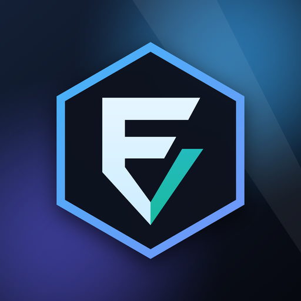

<p align="center">
  
</p>

<h1 align="center">FinVault</h1>

<p align="center">
  <strong>Offline Personal Budget & Savings Visualizer for Android</strong><br />
  Built with Kotlin, Jetpack Compose, and Material 3
</p>

<p align="center">
  
  
  
  
</p>

---

## Overview

**FinVault** is a lightweight, 100% offline personal finance application designed for speed, privacy, and visual clarity on modern Android devices. All records are stored locally on your device with zero accounts, zero tracking, and zero cloud dependencies.

## Key Features

- **Matte Titanium Ledger Card:** Displays Net Liquid Balance, Vault Savings Reserved, Monthly Spending Cap progress, **Safe to Spend Today** daily allowance, and estimated **Cash Runway**.
- **Purchase Impact Simulator:** Preview how a planned purchase affects your liquid balance, monthly cap, daily allowance, and savings goal opportunity cost—with a one-tap **Skip Purchase & Save** button to reward disciplined spending.
- **Month Navigator & Live Search:** Browse transaction history by individual month or across **All Time**, search instantly by title, category, or note, and filter by **All**, **Expenses**, or **Income**.
- **Quick Presets & Undo Delete:** Save recurring allowances or expenses for one-tap logging, choose transaction dates (**Today**, **Yesterday**, **2 Days Ago**), duplicate entries, and recover accidental removals with a 5-second **Undo** banner.
- **Financial Insights Dashboard:** Includes a live **Vault Health Score (0–100)**, **No-Spend Streak** tracker, **Largest Expense** spotlight, **Cash Flow Balance** comparison, **Seven-Day Spend Trend** curve, and an interactive **Category Allocation** ring.
- **Milestone Savings Goals:** Track multiple savings targets with 25% / 50% / 75% milestone markers, custom accent colors, one-tap deposit presets, and full goal editing.
- **Offline Backup & Spreadsheet Export:** Export or restore full **JSON** backups and generate **CSV** spreadsheet statements directly via clipboard.
- **Built-In Support & Privacy-Safe Diagnostics:** Contact the developer via Email, GitHub Issues, or Android Share Sheet with optional diagnostic and crash logs (strictly excluding financial amounts and personal notes).
- **Curated Themes & Privacy Masking:** Switch between **Titanium Ice**, **Jade Slate**, **Cobalt Pulse**, and **Rose Quartz**, and toggle one-tap balance masking (`₱••••••`).

## Project Structure

```text
FinVault/
├── assets/
│   └── finvault-icon-512.png          # High-Resolution Repository & Release Icon
├── app/
│   └── src/main/
│       ├── kotlin/com/yuri/finvault/
│       │   └── MainActivity.kt        # Complete Jetpack Compose Application
│       └── res/
│           ├── drawable/
│           │   ├── ic_launcher_background.xml
│           │   └── ic_launcher_foreground.xml
│           ├── mipmap-anydpi-v26/
│           │   ├── ic_launcher.xml
│           │   └── ic_launcher_round.xml
│           └── mipmap-*/              # Density-Specific Launcher Icons (mdpi–xxxhdpi)
├── CHANGELOG.md                       # Separated Major & Minor Upgrade History
├── LICENSE                            # MIT Open-Source License
└── README.md
```

## Building the Application

### On Mobile (CodeAssist)
1. Create or open a **Jetpack Compose App** project with package name `com.yuri.finvault` (`minSdk 26`, `targetSdk 36`).
2. Copy `app/src/main/java/com/yuri/finvault/MainActivity.kt` and the `app/src/main/res/` icon folders into your project directory.
3. Update `versionCode` to `4` and `versionName` to `"2.2.0"` in `app/module.toml`.
4. Tap **Run (▶)** → **Run Debug · app** (or **Run Release · app** with your signing keystore for GitHub Releases).

### On PC (Antigravity / Android Studio)
1. Open the exported Gradle project in **Antigravity** or **Android Studio**.
2. Verify `versionCode = 4` and `versionName = "2.2.0"` in `app/build.gradle.kts`.
3. Build a debug or release APK via `./gradlew assembleRelease` or the IDE build action.

## Author & Credits

- **Creator & Lead Developer:** Yuri Rinkashime
- **Repository:** [github.com/YuriRinkashime/FinVault](https://github.com/YuriRinkashime/FinVault)

## License

This project is released under the **MIT License**. See the [LICENSE](LICENSE) file for complete terms.
